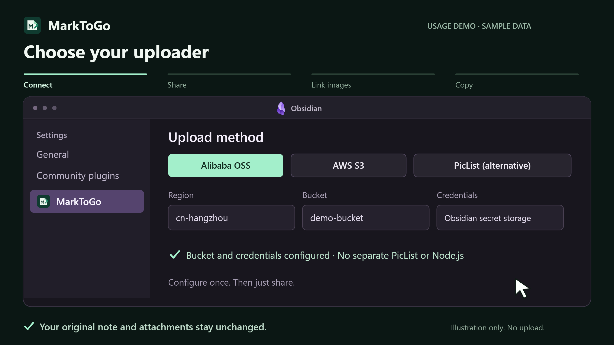

# MarkToGo


[简体中文](README.zh-CN.md) · [Website](https://scstc.github.io/mark-to-go/?lang=en) · [User guide](https://scstc.github.io/mark-to-go/?lang=en#guide-install) · [Release history](https://scstc.github.io/mark-to-go/?lang=en#releases) · [Latest release](https://github.com/scstc/mark-to-go/releases/latest) · [Obsidian directory](https://community.obsidian.md/plugins/mark-to-go)

Share an Obsidian note without sending its images separately. **MarkToGo uploads local images through PicList or directly to Alibaba Cloud OSS or AWS S3 and copies Markdown with online image links. Your original note stays unchanged.**

## Usage walkthrough

<a href="https://scstc.github.io/mark-to-go/usage-demo-en-animated.png?v=hd-2880">
  <picture>
    <source media="(prefers-reduced-motion: reduce)" srcset="docs/site/public/usage-demo-en.png">
    
  </picture>
</a>

A 13-second, 2880 × 1620 animated PNG using a sample note and preset storage; it performs no uploads. **Copy file** is available on Windows. Reduced-motion preferences show a static preview.

[Open the full-size animation](https://scstc.github.io/mark-to-go/usage-demo-en-animated.png?v=hd-2880) · [Play or pause on the website](https://scstc.github.io/mark-to-go/?lang=en#demo)

## Install

Find **MarkToGo** in **Settings → Community plugins → Browse**, then install and enable it. Alternatively, download `main.js`, `manifest.json`, and `styles.css` from the [latest GitHub release](https://github.com/scstc/mark-to-go/releases/latest) into `<Vault>/.obsidian/plugins/mark-to-go/`.

Desktop only. Windows has been tested; macOS and Linux have not yet been tested.

## Choose an upload method

Select **Settings → MarkToGo → Upload method**. We recommend a direct OSS or AWS S3 connection, with PicList as an alternative. Existing installations retain their selected provider, saved paths and preferences; installations upgrading from PicList-only versions keep PicList. Switching keeps all three configurations.

### Alibaba Cloud OSS (direct)

Requires Obsidian **1.11.4+**, an existing OSS bucket and a RAM AccessKey with `oss:PutObject` permission limited to your chosen prefix, for example `acs:oss:*:*:your-bucket/mark-to-go/*`. No PicList or separate Node.js installation is needed.

1. Select **Alibaba Cloud OSS** and enter the region ID (such as `cn-hangzhou`), Bucket name and AccessKey ID.
2. Select or create your **AccessKey Secret** using Obsidian secret storage. Plugin settings store only its reference name. Configure the secret separately on each device; do not paste it into a note or the upload cache.
3. Keep the default **OSS folder** `mark-to-go/`, or choose your own. Optionally set a public HTTPS image base URL, including a path if needed. Otherwise, links use the official OSS endpoint.

Links are permanent, unsigned URLs: your bucket policy or public image domain must allow anonymous image reads. The plugin does not change bucket or object ACLs. A custom image base URL affects links only; authenticated uploads always use the standard regional OSS HTTPS endpoint. STS and expiring signed links are not supported.

Object names use a full SHA-256 hash of image bytes and extension. Different images with the same local filename get different names; identical bytes with the same extension reuse the same object. Original filenames are not sent as object names. Concurrent uploads or clearing the cache can write the same content-addressed object again; bucket versioning may retain additional versions. Images are streamed from temporary snapshots. Cancellation and timeouts stop the local request, but an object already accepted by OSS may remain.

**Check local configuration** validates fields and secret availability without a network request. It does not confirm OSS permissions or anonymous image access; verify a shared image URL in a browser after your first export.

### AWS S3 (direct)

Requires Obsidian **1.11.4+**, an existing AWS S3 general purpose bucket and an IAM access key. Select **AWS S3**, enter the region (for example `us-east-1`), Bucket and **Access key ID**, then select or create the **Secret access key** in Obsidian secret storage. The default folder is `mark-to-go/`. No PicList or separate Node.js installation is needed.

Grant only `s3:PutObject` on the target prefix, for example `arn:aws:s3:::your-bucket/mark-to-go/*` (`arn:aws-cn:s3:::` for AWS China). Buckets using SSE-KMS may also require KMS permissions. AWS China regions use `amazonaws.com.cn`. Dotted bucket names use path-style HTTPS to match AWS certificates.

Permanent, unsigned image links need anonymous read access through your bucket policy or a public image domain such as CloudFront. Set **Public image base URL** to that HTTPS domain when needed. The plugin does not change Block Public Access, bucket policies or object ACLs. Uploads use AWS SigV4 and stream signed snapshot bytes to the official regional endpoint, while cache entries stay separate from PicList and OSS. Filenames use full content hashes, and original notes remain unchanged.

This option supports standard AWS S3 endpoints and long-term IAM access keys. Custom S3-compatible endpoints, directory buckets, STS session tokens and expiring signed links are not supported. **Check local configuration** performs no network request and does not verify IAM or public read permissions.

### PicList

**PicList is an image uploader, not an image hosting service.** You need an image host of your own, such as an object storage bucket, and configure it in PicList.

| Component | What it does |
| --- | --- |
| Image host | Stores the uploaded images and provides URLs recipients can access. |
| PicList desktop | Lets you configure your image host, credentials, and default uploader. |
| PicList CLI | Lets MarkToGo upload images using that configuration. Install it separately below. |

1. Install [PicList desktop](https://piclist.cn/), configure your image host, and select it as the default. **Upload a test image in PicList and make sure its URL opens in a browser.**
2. Install [Node.js LTS](https://nodejs.org/), then run this in a terminal:

   ```sh
   npm install -g piclist
   ```

3. Enable MarkToGo. It tries to find Node.js, the CLI, and your desktop PicList configuration automatically. Leave those settings blank initially.

**The npm package is named `piclist`, but its command is named `picgo`.** Installing desktop PicList alone is not enough. The original PicGo CLI and `PicList.exe` are not the CLI this plugin expects. After configuration, the desktop app does not need to stay open.

## Share a note

1. Right-click a Markdown note and choose **MarkToGo** next to the **MTG** icon.
2. Paste the copied Markdown wherever you want to share it. Local image links in this copy now point to your image host.
3. On Windows, select **Copy file** in the result dialog to paste a `.md` attachment into an app that accepts files. **Copy text** copies the Markdown body instead. Select **Save to Downloads** to keep an exported file.

The dialog shows new and reused uploads. Copying a file or saving does not upload again; original notes and attachments are preserved. By default, only text is copied. **Copy file** uses a Windows temporary file with the original note name, without writing to Downloads or the export folder. Closing the dialog keeps the attachment available for pasting. The previous MarkToGo temporary attachment is removed when another file replaces it; other temporary copies may remain in the system temporary folder.

## If PicList cannot be found

Select **Settings → MarkToGo → Check local configuration** first. This checks local programs, configuration and folders without uploading images, running PicList plugins, creating export folders or changing the clipboard. It does not test your image-host credentials or network connection.

Open **Settings → MarkToGo** and fill in only the paths that automatic discovery could not find:

| Setting | What to enter |
| --- | --- |
| PicList CLI entry | Run `npm root -g`, then append `/piclist/bin/picgo` to that directory. Enter the full file path. |
| Node.js path | The full path to `node` or `node.exe`. |
| PicList configuration file | Your desktop PicList `data.json`; on Windows, usually `%APPDATA%\piclist\data.json`. |

The CLI's default `~/.piclist/config.json` is a different file. **Use the desktop configuration you already tested.** If upload fails, first confirm desktop PicList can still upload and that the resulting image URL is accessible. See the [advanced guide](docs/advanced.md) for more settings and platform paths.

## Good to know

- Supports PNG, JPEG, GIF, WebP, SVG, standard Markdown images, reference images, and Obsidian image embeds. Existing online image links are preserved.
- Excalidraw notes must be exported to PNG/SVG first. HTML images, ordinary attachment links, and note links are not converted.
- Images inside Obsidian `%%…%%` comments are not uploaded. The comment text itself remains in the shared Markdown; this is not a redaction feature.
- When sharing several notes, the latest share or explicit copy action takes priority for the clipboard. Older results remain available for manual copying.
- Upload mappings are stored in `MarkToGo/upload-cache.json`. Sync this folder with your vault to reuse uploads on other computers. Simultaneous first uploads can still duplicate; there is no cross-device lock.
- Saving currently requires a file system with hard-link support, such as NTFS. Exported files never overwrite existing ones.
- Choose **Follow Obsidian**, **English**, or **简体中文** in the language setting.

## Privacy

Only an explicit export sends referenced local images through your PicList CLI to your configured image host, or directly to your chosen Alibaba Cloud OSS or AWS S3 bucket. Authentication uses the access key ID and a signature derived from the locally stored secret; the secret itself is not sent. Note text is not uploaded to the image host, and MarkToGo collects no telemetry. MarkToGo is free; your chosen host may require an account or payment.

To upload and save exports, the plugin accesses Node.js/PicList, your PicList configuration and installed plugins, temporary files, and Downloads or your chosen export folder outside the vault. Temporary copies protect the original images and configuration. See the [advanced guide](docs/advanced.md) for details.

## Development

Build, cache behavior, limitations, and the roadmap are in the [advanced guide](docs/advanced.md). Versions follow **`YY.quarter.release-number`**: `26.4.1` means the first release in Q4 2026, followed by `26.4.2`.

[0-BSD license](LICENSE). Based on the [official Obsidian sample plugin](https://github.com/obsidianmd/obsidian-sample-plugin).
